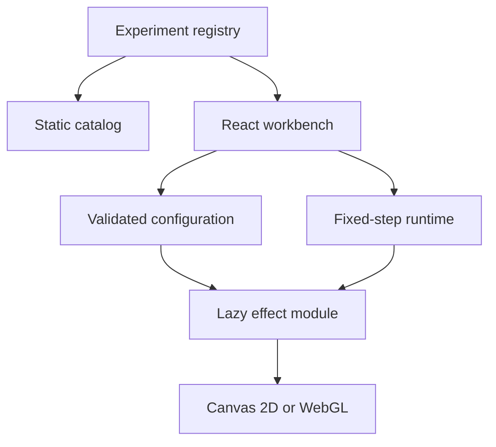

# Architecture and decisions

- `registry.ts`: experiment metadata, controls, presets, schema validation, dynamic imports.
- `main.tsx`: directory, filtering, workbench controls, share and JSON actions.
- `core.ts`: renderer contract, seeded random source, reflection, exact line-length reservation, lifecycle scheduling.
- `effects/`: independent renderers, without React imports.
- `public/baseline/`: unchanged original light prototype for comparison.

## State ownership

React owns selected experiment, parameters, seed, pause preference, and UI state. Renderers own simulation and rendering resources. The runtime owns scheduling. The URL is a serialized configuration snapshot, updated on share, selection, or import. Slider changes remain local until shared. Invalid URL configuration displays an explanatory message instead of starting an unknown experiment.

## Lifecycle

Selecting an experiment cancels pending initialization of the previous selection. On unmount the ResizeObserver, animation frame, visibility listener, reduced-motion listener, pointer listener, and GPU resources are disposed by their owning layer. An async module resolving after unmount does not create a renderer. A paused or hidden experiment has no scheduled animation frames.

## Rendering choice

The UI uses React, while renderer modules use native browser APIs. Chromatic drift uses a fullscreen WebGL triangle rather than a 3D engine: it needs no scene graph, camera, meshes, or imported models. Future experiments can dynamically import Three.js when those capabilities are needed. This keeps the MVP's effect dependencies small.

## Density budget

Angular light trails reserve each incremental segment before committing movement. Segments are split at their exact intersections with grid boundaries; interval length is added to the corresponding cell. Rebuilding occupancy and incremental admission therefore use the same geometric measure. A failed admission stops the ray and starts its decay. Settings that reduce capacity reset the experiment immediately. Count includes both growing and fading rays.

Particle movement updates a cell occupancy map sequentially and refuses entry into a full destination cell. It limits particle-center concentration; it does not impose a hard luminance or trail-length budget.

## Reproducibility

A seeded LCG and a fixed simulation timestep provide repeatable CPU simulation at a given viewport. Configurations are versioned, bounded, and quantized to control steps. GPU output can differ by implementation. Resize resets simulation. Manual emitter relocation and playback time are intentionally not serialized in v1 and are disclosed in the UI.

## Deployment

Vite emits a static `dist` with separate lazy effect chunks. Relative asset URLs permit subpath hosting. The Sites manifest declares `dist`; no server bindings or credentials are required. GitHub CI runs tests/build and retains the static artifact. It does not claim browser coverage or automatically publish to a second hosting provider.

## Procedural lifeforms

- `effects/lifeforms-model.ts`: pure seeded particle topology, independently authored jellyfish/anemone/fish morphology, 12-second periodic local deformation, closed global swim transform, deterministic quality-diversity candidate sampling, and simple image silhouette extraction.
- `effects/lifeforms.ts`: independent Canvas 2D renderer with adaptive scale, DPR clamp, and a per-cell particle count cap.
- `LifeformsExplorer.tsx`: local image decoding (max 8 MB), approximate foreground aspect-ratio extraction, candidate gallery, and apply-to-workbench.
- Candidate choice updates only seed and validated parameter fields, so sharing/export reuses the existing snapshot format.
- Image bytes and derived reference ratios are ephemeral local UI state; images never enter the URL, repository, or telemetry. Image analysis does not include semantic segmentation, skeletal extraction, or a learned perceptual model.
- Inspiration: [@yuruyurau](https://x.com/yuruyurau?s=21); geometry and animations are independently authored. Avoid importing the author's original compressed mathematical sketches or claiming endorsement.

### Verification constraints

Tests cover seed determinism, morphology and swim loop closure, candidate diversity/bounds, snapshot round trips, and approximate silhouette extraction. They do not prove biological fidelity, aesthetic quality, actual GPU/mobile FPS, or cross-browser layout. Browser QA remains necessary.

## Index-space interference renderer (2026-10)

- `effects/lifeforms-interference.ts`: pure deterministic index-space transformation and shared Canvas painter used by the full-size renderer and candidate previews.
- `effects/lifeforms.ts`: dispatches `shape >= 4` to the index-space algorithm while preserving legacy 3D parametric species at shapes 0-3.
- `registry.ts`: two new presets, preserved integer snapshot schema and original legacy shape IDs.
- Spatial interference mode avoids local occupancy rejection to preserve bright folds, and uses alpha accumulation plus globally adaptive point count. Cell measurements are diagnostic, not a hard brightness constraint.
- A constant normalized index domain prevents level-of-detail changes from altering global geometry. All runtime formula phases close after 12s, with tests for zero-to-period continuity.
- The approach is an original mathematical implementation informed by general public creative coding mechanisms. Do not copy individual artists' formulas into this open-source project without appropriate permission.

## Replacement of the jellyfish morphology (shape=0)

- `lifeforms-jellyfish-field.ts` defines a pure index-to-2D-position sampler. Its bell is a ring-domain fold with several phase-coupled frequencies; folded oral ribbons and trailing thread families share the same mathematical index domain.
- The existing `paintInterference` accepts an optional sampler. By default, interference/fold formulas remain unchanged, with exactly the same alpha as before. Shape 0 injects `jellyfishFieldPoint` and uses its per-layer alpha.
- The display samples the entire fixed index range during performance-adaptive LOD. Brightness is limited via source-over alpha compositing; rejecting locally dense points would destroy the interference structure.
- `shape=0` remains stable in links, imports and JSON. `LifeformsExplorer` previews call the same source sampler. No new external dependencies.
- Explicit note: the model independently uses mathematical principles; it does not claim literal reproduction or license to reuse another artist's implementation.

## Interference anemone replacement (shape=1)

- `lifeforms-anemone-field.ts`: pure indexed generator with 35% compact folded core, 22% short crown fibers and 43% long outwardly radiating families. Multiple co-phased fiber lanes create a bundled appearance while delayed harmonics open and curl the crown.
- Shape 1 dispatches through the same alpha-accumulating `paintInterference` as jellyfish shape 0 and unchanged mathematical modes 4/5. The browser explorer uses exactly the same callback.
- Old shape=1 URLs and JSON remain valid; the visible preset and selector labels change to 海葵·干涉. The 12-second loop, seed reproducibility, global LOD, topology coverage and real desktop/mobile canvas are tested by CI.
- The model is independently authored; visual inspiration credit is retained for @yuruyurau without importing the author's exact sketches.

## Interference fish swimmer replacement (shape=2)

- `lifeforms-fish-field.ts` is a pure seeded index-to-2D sampler using three correlated domains: 58% bounded fish silhouette, 20% dorsal/ventral/pectoral folds and anatomical orientation cues, 22% split caudal fan and restrained wake.
- Time-dependent harmonics share the 12-second period. Traveling wave amplitude rises toward the tail while head coordinates remain stable; the body, fins and tail are separately parameterized but rendered as one index-space field with alpha accumulation.
- Shape=2 keeps old URL and JSON compatibility and uses the same `paintInterference` evaluator in workbench and morphology explorer. No new dependencies or browser uploads.
- Existing jellyfish (0), anemone (1), interference (4) and folded (5) samplers are unchanged. Browser QA screens desktop and mobile fish scenes, six candidate thumbnails and regression checks.
- All fish formulas are independently authored mathematical art; credit to @yuruyurau is for inspiration rather than a claim of affiliation or exact code reuse.
