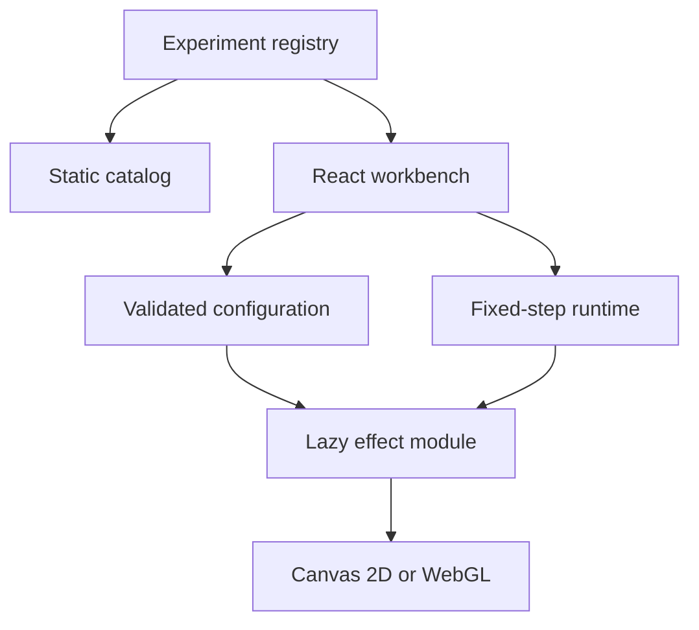

# Architecture and decisions

- `registry.ts`: experiment metadata, controls, presets, schema validation, dynamic imports.
- `main.tsx`: directory, filtering, workbench controls, share and JSON actions.
- `core.ts`: renderer contract, seeded random source, reflection, exact line-length reservation, lifecycle scheduling.
- `effects/`: independent renderers, without React imports.
- `public/baseline/`: unchanged original light prototype for comparison.

## State ownership

React owns selected experiment, parameters, seed, pause preference, and UI state. Renderers own simulation and rendering resources. The runtime owns scheduling. The URL is a serialized configuration snapshot, updated on share, selection, or import. Slider changes remain local until shared. Invalid URL configuration displays an explanatory message instead of starting an unknown experiment.

## Lifecycle

Selecting an experiment cancels pending initialization of the previous selection. On unmount the ResizeObserver, animation frame, visibility listener, reduced-motion listener, pointer listener, and GPU resources are disposed by their owning layer. An async module resolving after unmount does not create a renderer. A paused or hidden experiment has no scheduled animation frames.

## Rendering choice

The UI uses React, while renderer modules use native browser APIs. Chromatic drift uses a fullscreen WebGL triangle rather than a 3D engine: it needs no scene graph, camera, meshes, or imported models. Future experiments can dynamically import Three.js when those capabilities are needed. This keeps the MVP's effect dependencies small.

## Density budget

Angular light trails reserve each incremental segment before committing movement. Segments are split at their exact intersections with grid boundaries; interval length is added to the corresponding cell. Rebuilding occupancy and incremental admission therefore use the same geometric measure. A failed admission stops the ray and starts its decay. Settings that reduce capacity reset the experiment immediately. Count includes both growing and fading rays.

Particle movement updates a cell occupancy map sequentially and refuses entry into a full destination cell. It limits particle-center concentration; it does not impose a hard luminance or trail-length budget.

## Reproducibility

A seeded LCG and a fixed simulation timestep provide repeatable CPU simulation at a given viewport. Configurations are versioned, bounded, and quantized to control steps. GPU output can differ by implementation. Resize resets simulation. Manual emitter relocation and playback time are intentionally not serialized in v1 and are disclosed in the UI.

## Deployment

Vite emits a static `dist` with separate lazy effect chunks. Relative asset URLs permit subpath hosting. The Sites manifest declares `dist`; no server bindings or credentials are required. GitHub CI runs tests/build and retains the static artifact. It does not claim browser coverage or automatically publish to a second hosting provider.

## Procedural lifeforms

- `effects/lifeforms-model.ts`: pure seeded particle topology, independently authored jellyfish/anemone/fish morphology, 12-second periodic local deformation, closed global swim transform, deterministic quality-diversity candidate sampling, and simple image silhouette extraction.
- `effects/lifeforms.ts`: independent Canvas 2D renderer with adaptive scale, DPR clamp, and a per-cell particle count cap.
- `LifeformsExplorer.tsx`: local image decoding (max 8 MB), approximate foreground aspect-ratio extraction, candidate gallery, and apply-to-workbench.
- Candidate choice updates only seed and validated parameter fields, so sharing/export reuses the existing snapshot format.
- Image bytes and derived reference ratios are ephemeral local UI state; images never enter the URL, repository, or telemetry. Image analysis does not include semantic segmentation, skeletal extraction, or a learned perceptual model.
- Inspiration: [@yuruyurau](https://x.com/yuruyurau?s=21); geometry and animations are independently authored. Avoid importing the author's original compressed mathematical sketches or claiming endorsement.

### Verification constraints

Tests cover seed determinism, morphology and swim loop closure, candidate diversity/bounds, snapshot round trips, and approximate silhouette extraction. They do not prove biological fidelity, aesthetic quality, actual GPU/mobile FPS, or cross-browser layout. Browser QA remains necessary.
